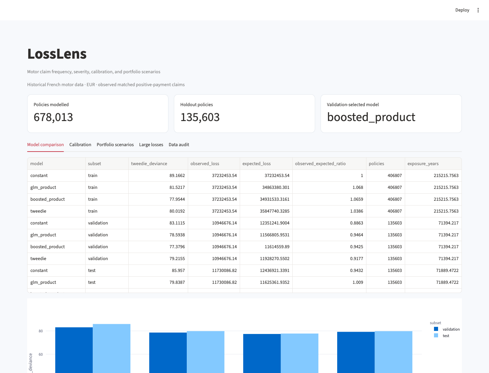

# LossLens

A reproducible motor-insurance loss-cost study that separates claim frequency and severity, compares interpretable and boosted models, and investigates calibration and large-loss sensitivity.



## What it does

- Full public policy/payment data audit, orphan-record accounting and explicit target reconciliation.
- Policy-disjoint 60/20/20 training, validation and test partitions.
- Constant baseline, spline-feature Poisson/Gamma product, boosted-frequency product and direct Tweedie model.
- Exposure-aware fitting, validation-only model selection, holdout calibration and policy bootstrap intervals.
- Empirical deductible/limit curves and GPD tail-threshold sensitivity using training claims only.
- Interactive portfolio scenarios, Excel pricing review, serialized models, PDF report and standalone charts.

## Run locally

Python 3.12 is the tested runtime.

```bash
python3 -m venv .venv
source .venv/bin/activate
python -m pip install -e '.[dev]' -c constraints.txt
losslens run
streamlit run app.py --server.port 8513
```

Run these commands from this repository. For a non-editable installation or a different working
directory, set `PROJECT_ROOT` to the repository path. Raw downloads, local models and processed
datasets are ignored by Git; the run command regenerates them. Reports are included for review.
Network access is required for first-time public-data/model downloads where applicable.

`constraints.txt` records the dependency versions used in local validation. It is a tested version
constraint set, not a cross-platform hash lock. Ordinary dependency resolution still handles
platform-specific packages. Runtime dependencies are declared in `pyproject.toml`.

## Inspect the evidence

- analysis.pdf — findings, target definition and limitations
- data_audit.json — source counts, mismatches and treatments
- model_comparison.csv — train/validation/test model scores
- risk_calibration.csv — holdout observed/expected by risk band
- age_calibration.csv and region_calibration.csv — segment diagnostics
- tail_sensitivity.csv and limited_loss_curves.csv — training-claim tail study
- pricing_review.xlsx — review pack
- policy_splits.csv — reproducible policy partition assignments

Outputs live in `reports/`. [Read the generated analysis](reports/analysis.md),
[methodology](docs/methodology.md), [data dictionary](data/README.md),
and [validation record](docs/validation.json).

## Data and scope

OpenML 41214 (freMTPL2freq) and 41215 (freMTPL2sev), originating from CASdatasets by C. Dutang and A. Charpentier. OpenML lists CC0. Historical French motor third-party liability; amounts EUR, exposure years. The local frequency snapshot has 678,013 policy rows. The target is observed matched positive-payment losses, not ultimate notified claims or an Indian insurance tariff.

Per-source download records store hashes and timestamps. A pre-existing local download is
identified as such if its original retrieval time was not captured. `data/provenance.json`
records the dataset and treatment assumptions. Refresh public sources explicitly when needed;
refreshing can change results.

## Walkthrough

1. Read the audit before comparing model scores: notified claim counts and linked payments differ.
2. Compare all models on validation and test rows; the reported selection uses validation deviance.
3. Inspect risk-band and region calibration, including sparse-group flags.
4. Change region mix, exposure and assumed inflation/expenses in the portfolio scenario.
5. Compare empirical layer curves and threshold-dependent tail fits. Keep observed findings separate from commercial loading assumptions.

## Validate

```bash
python -m pytest -q
python -m ruff check src tests
python scripts/verify_artifacts.py
```

Unit tests use small, interpretable fixtures. Artifact verification checks reconciliations,
report/workbook structure and generated-file hashes. Generate the data before running the
artifact verifier. The validation record distinguishes executed checks from deployment configuration.

## Container

After generating the project data, build from this repository:

```bash
docker build -t losslens:local .
docker run --rm -p 127.0.0.1:8513:8501 losslens:local
```

The build copies generated local inputs so the application can open them. Rebuild after
regeneration. Docker configuration does not itself establish a hosted deployment. Development
servers bind to local ports in these examples.

## Layout

```text
src/losslens/     analytical code, CLI and application
tests/                correctness and boundary fixtures
data/                 provenance, dictionary and regenerable inputs
reports/              measured results and shareable artifacts
docs/                 methodology, preview and validation evidence
scripts/              standalone artifact verification
```
